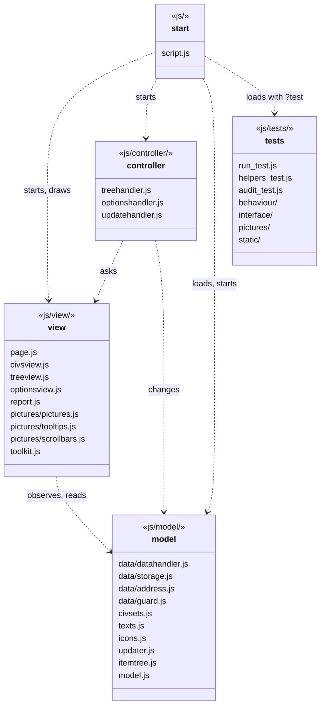

# AoE2 Civ Explorer: maintainer's guide

1. [Updating Civ Explorer after a game patch](#updating-civ-explorer-after-a-game-patch)
2. [How the code works](#how-the-code-works)
   - [Files and folders](#files-and-folders)
   - [UML diagram](#uml-diagram)
   - [How model, view and controller work together](#how-model-view-and-controller-work-together)
   - [The data](#the-data)
   - [How marking works](#how-marking-works)
   - [Simple UI and the pictures](#simple-ui-and-the-pictures)
   - [Assets](#assets)
   - [Tests](#tests)
   - [Rules for changing the code](#rules-for-changing-the-code)

## Updating Civ Explorer after a game patch

After a patch, [aoe2techtree.net](https://aoe2techtree.net/) publishes the game's new data. The page has an updater
built in: it fetches that data, tells you what changed, and gives you new data files to save. You need a browser, a
text editor such as Visual Studio Code, and about ten minutes. You do not need to know how to program.

1. **Wait for aoe2techtree.net.** Its footer says which game update its data comes from. Wait until that matches the
   new patch.
2. **Open the page on your computer.** A browser will not let a page read files straight from your disk, so the
   folder has to be served. In Visual Studio Code with the Live Server extension, open the project folder, right-click
   `index.html` and choose **Open with Live Server**. The page opens at an address such as
   `http://127.0.0.1:5501/index.html`. You can also use the published page's address instead.
3. **Run the updater.** Add `?update` to the address, for example `http://127.0.0.1:5501/index.html?update`. A window
   called **Update the data files** fetches the new data, which takes a few seconds, and lists what it found. Nothing
   is changed yet.
4. **Read the report.** Most lines need nothing from you. These do:
   - *In the source data, but not yet in the tree: …* The patch added a building, unit or technology. Put it in the
     tree (step 5), or add its name to `ignore` in `data.json` to leave it out.
   - *In the tree, but not in the source data: …* or *In the tree more than once: …* Fix the tree (step 5). The
     updater stops until you do.
   - *No civilisation has: …* It was probably removed from the game. Consider removing it from the tree.
   - *In the source data now, so it can be taken out of extras: …* aoe2techtree.net now has an item that was added
     by hand. Delete its entry under `extras` in `data.json` (see [The data](#the-data)) and reload the `?update` page.
   - *New icon for …: …* Copy the file it names from the `img` folder of
     [aoe2techtree's repository](https://github.com/SiegeEngineers/aoe2techtree): `img/Unit/912.png` goes to
     `assets/images/icons/nodes/unit/912.png`, and the same for `Building` and `Tech`. Then build that folder's
     atlas again (see [Assets](#assets)). The updater has already added the number to `atlas` in `data.json`.
   - *New civilisation: …* Its names are added for you. Add its icon to `assets/images/icons/civs/`, named after its
     English name in lower case, such as `celts.png`, and build the civilisations' atlas again (see
     [Assets](#assets)).
   - *… has no text for: …* A language file is missing a sentence or a heading. Add it under `text` in that file (see
     [The data](#the-data)).
   - *New name in … for …: …* Nothing, unless the new name is wrong. Then add the right one to `overrides` in that
     language's file, with the English name on the left, such as
     `"Heavy Mounted Crossbowman": "Schwerer berittener Armbrustschütze"` in `locales/de.json`. English corrections
     go in `overrides` in `data.json`. Reload the `?update` page afterwards.
   - *New game update: …* Nothing. The footer will name the new update and link its notes, as aoe2techtree.net's does.
   - *The game update could not be read from …* aoe2techtree.net's page now writes it differently. Put the number
     and the address of its notes under `update` in `source` in `data.json` by hand, and report the problem.
5. **Change the tree, if the report asked you to.** Open `data.json` and find `"tree"`. It reads like an outline:
   each entry is a row of the left pane, and `"kids"` lists the rows under it.

   ```json
   {"item": "Stable", "kids": [
     {"item": "Scout Cavalry", "kids": [
       {"item": "Light Cavalry", "kids": [
         {"item": "Hussar"}
       ]}
     ]},
   ```

   - `"item"` is the English name, **exactly** as the report wrote it.
   - Put a building at the top or in a group, its units and technologies under it, and each upgrade under the unit
     or technology it upgrades, as Light Cavalry is under Scout Cavalry. Walls and towers in Fortifications are
     lines too, as the Keep is under the Guard Tower. Marking works along these lines (see
     [How marking works](#how-marking-works)).
   - A new unique unit goes straight into the building that trains it, after its other units and before its
     technologies, as the Grenadier is in the Archery Range; only the Castle keeps a Unique Units group. A new unique
     technology goes into the Castle's Unique Technologies. Both keep the alphabetical order of the unique items
     around them. A unique upgrade goes under the unit it upgrades instead, as the Imperial Skirmisher is under the
     Elite Skirmisher. A new unique building has no group: it goes straight into Economy or Military, next to the
     building it stands in for (see `"replaces"` in [How marking works](#how-marking-works)), or under the building it
     belongs to, as the Harbor is the first row under the Dock. A unit or technology that stands in for another, as
     the Fire Lancer does for the Eagle Scout, Cranequins for Parthian Tactics and the Legionary, under the Long
     Swordsman, for the Two-Handed Swordsman, names it with `"replaces"` too.
   - Every entry in a list is followed by a comma, except the last one. Visual Studio Code underlines mistakes in red.

   Reload the `?update` page. The report should no longer mention those items.
6. **Download the new files.** At the end of the report's list, which scrolls between the window's title and its
   **Close** button, is a link for each file that changed: always **Download data.json**, and one for each language
   file that changed, such as **Download locales/de.json**. Save each over the old file of the same name.
7. **Run the tests.** Open the page with `?test` instead, such as `http://127.0.0.1:5501/index.html?test`, and wait
   about half a minute. A window then says **All … tests passed**, or names the tests that failed by their number in
   `TESTS.md`, each with what is wrong and where.
8. **Publish.** Commit the changed files and push them, for example with GitHub Desktop. GitHub runs the tests again
   in several window sizes, in light and dark colours; a green tick in the repository's **Actions** tab means they
   all passed.

With Claude Code, the `data-update` skill in `.claude/skills/` runs steps 2 to 7, and stops to ask about any line of
the report that needs you.

## How the code works

The page is plain HTML, CSS and JavaScript. There is nothing to install and nothing to build: the files in the
project are exactly what a visitor's browser downloads. The most important idea is that **all facts and all text
live in `data.json` and the language files**. The code never names a unit, a civilisation or a sentence, which is
why a game update changes only those files, and sometimes adds an icon.

### Files and folders

| File or folder | What it holds |
| --- | --- |
| `index.html` | The structure of the page. Its only text is what shows before the data loads, such as the loading screen. |
| `css/base.css` | How the page looks with Simple UI, and its layout either way: big and small screens, light and dark colours. |
| `css/pictures.css` | How the page looks without Simple UI: every rule with a picture or a font, the loading screen, the tooltip and the scroll bars. |
| `js/script.js` | Where the page starts. |
| `js/model/` | The data and the tree's rules, which tell the page when they change, and the updater: `data/` (the files, the browser's storage and the address: `datahandler.js`, `storage.js`, `address.js` and `guard.js`), `civsets.js`, `texts.js`, `icons.js`, `updater.js`, `itemtree.js` and `model.js`. |
| `js/view/` | What the page shows: `page.js` (the whole page), `civsview.js` (the civilisations and **Filters**), `treeview.js` (the tree), `optionsview.js` (Options), `report.js` (the report window), `pictures/` (the picture look: `pictures.js`, `tooltips.js` and `scrollbars.js`) and `toolkit.js` (what every view uses). |
| `js/controller/` | What the visitor's clicks, touches and keys mean: `treehandler.js` (the tree and **Filters**), `optionshandler.js` (Options) and `updatehandler.js` (the updater). |
| `js/tests/` | The tests, loaded only when the address ends in `?test`; see [Tests](#tests). |
| `data.json` | The data and the English text; see [The data](#the-data). |
| `favicon.ico` | The tab icon. Browsers fetch it from the main folder by themselves, so no code names it. |
| `locales/` | One file per other language, such as `de.json` for German. |
| `assets/` | Pictures and fonts, used only when Simple UI is off; see [Assets](#assets). |
| `documentation/` | This guide, `RULES.md`, `REQUIREMENTS.md`, `TESTS.md`, `DECISIONS.md`, `code_docu.pdf`, and the development log in `DEVLOG/`. |
| `README.md` | Introduces the project. |
| `.github/workflows/tests.yml` | Tells GitHub to run the tests on every push. |
| `.github/runtests.sh` | Runs the tests in Chrome, as GitHub does and as you can; see [Tests](#tests). |
| `.claude/skills/` | How `code_docu.pdf` is made, and how the updater's files are put in place, as skills for Claude Code; see below. |

`code_docu.pdf` describes the code folder by folder: each folder is a chapter, a subfolder too, after the folder it is
in, each file in it a subchapter, and each function a section numbered after both, with its lines, the functions that
call it and those it calls. Every name of a folder, file or function links to its place. It also holds UML diagrams, the
one below and one of each part with its functions, a page on how `data.json` is laid out, and an index.

It is made again only when asked. Its steps, the descriptions of every function and the scripts that print it are in
`.claude/skills/`, as skills for Claude Code: asked to make `code_docu.pdf` again, Claude Code follows
`.claude/skills/code-docu/SKILL.md`. They use Node, Chrome and Python, which Rule 36 allows for this alone; the page
itself never does. The `data-update` skill uses Node with no packages to do in Chrome what steps 2 to 7 of the update
guide do by hand.

### UML diagram

The diagram shows the code in its three parts. Each box is a folder with its scripts, and `start` is
`js/script.js`, which starts the page. Each arrow points from a part to a part whose scripts it uses, and says what
for. The tests use all three parts as well; those arrows are left out, because with them some arrows would have to
cross. `code_docu.pdf` adds a diagram of each part, function by function.



When a script is added or moved, or starts to use a script of another part, change the diagram to match: making
`code_docu.pdf` stops and names the box or arrow that no longer fits.

The scripts are in three folders: `js/model/` holds the data and the rules, `js/view/` what the page shows, and
`js/controller/` what the visitor's clicks, touches and keys mean. `js/script.js` starts them. A folder may hold one
level of subfolders: `js/model/data/` holds what reads and writes the files, the storage and the address, and
`js/view/pictures/` the picture look.

- **`js/script.js`** runs the start-up. It reads once whether the address asks for `?test` or `?update` (`MODE`), and
  `RUNS` says for each what languages to load, what to run once the page is up, and what to do if `data.json` cannot
  load. It turns Simple UI on or off as the visitor last chose (off on a first visit), which puts up the loading screen
  without it, and loads `data.json` and the visitor's language, or every language with `?test`. It then starts the
  model, which reads its own saved settings, the tree's and the Options window's controllers and the page, has the page
  drawn once, opens the popup `#languageError` if the visitor's language could not load, and lets the loading screen go
  once every picture has loaded. With `?test` it then runs the tests, and with `?update` the updater. Its failure
  handler sees only a failure to load, and shows `#loadError`. It never touches the page itself.
- **`js/model/data/datahandler.js`** is the Facade over the data: it loads and stores `data.json` and the language
  files, and passes on what the other three scripts of `js/model/data/` hold, so every other script imports from it
  alone, and none outside `js/model/data/` reads a file, the browser's storage or the address. `storage.js` holds the
  saved choices: `SETTINGS` lists each setting's values, the first being its default, and `recallSetting()` reads a
  saved setting back, or its default. `address.js` holds the address's `params` and `keepInAddress()`, and `guard.js`
  holds `attempt()`, which runs what the browser may refuse, such as its storage in a private window; the views use it
  too. `datahandler.js` also holds the language rule: `firstLanguage()` is the first language in `data.json`, English;
  `preferredLanguage()` the one in the address, else the one saved, else the first; `hasLanguage()` says whether a
  language has loaded; and `startLanguage()` is the preferred language if it loaded, else the first. `pack()` and
  `unpack()`, which split the data into its files and join them, use the same rule.
- **`js/model/civsets.js`** holds the civilisations as sets: which civilisations an item's rule in `availability`
  names, how many a set holds, and which they are.
- **`js/model/texts.js`** holds the chosen language: its texts, the names of items and civilisations, and its way of
  writing numbers, plurals and the order of names.
- **`js/model/icons.js`** names the icons' files, and the order of the files in an atlas, and finds each item's icon
  (`spriteOf()`, `atlasOf()`) and its cell in the atlas (`cellOf()`). `cellOf()` stops the page with an error for a
  picture that is not in its atlas, as the page would otherwise quietly show a cell outside it.
- **`js/model/updater.js`** fetches the game's newest data for `?update`, compares it with `data.json` and writes the
  new files.
- **`js/model/itemtree.js`** builds the tree's items from `data.json`: what Include and Include Regionals hide, the
  items a variant borrows from the building it replaces, and each item's rivals and alternatives. It also stores each
  item's branch set, the civilisations that have the item and everything under it. It holds the items, which
  `model.js` passes on, so the other scripts import them from `model.js`. It also answers questions about the tree's
  shape, which need no marks: an item's line of upgrades (`lineOf()`, `lineEnd()`, `endsInLine()`), the items under
  it in a chain (`chainOf()`, `itemChain()`), the items above it (`ancestors()`) and below it (`descendants()`), and
  whether it counts as a unit or technology (`isUnitOrTech()`). `treeKeys()` lists the names in the tree, which the
  updater uses too.
- **`js/model/model.js`** keeps the options, the marks, the filters and the counts, with the rules of marking: how
  marks pass on (see [How marking works](#how-marking-works)), which civilisations fit, the counts beside the names,
  which branches a mark greys out, and what **Filters** shows. Only its own functions change it (`toggleMark`,
  `clear`, `unmarkLine`, `unmarkLone`, `setInclude`, `setRegional` and `setLanguage`), and each then tells the page
  what changed; `toggleMark` refuses an item that is greyed out. It saves its own choices, Include, Include Regionals
  and the language, and the language in the address, and `startModel` reads them back. It never touches the page.
- **`js/view/page.js`** is the whole page: it holds the other views and passes each change to all of them, the model's
  notices as well as `redraw("start")` and `redraw("look")`. It also writes the page's fixed texts and the chosen
  language's texts, shows `#loadError`, opens the popup `#languageError`, which its **OK** closes, and shows the page
  once it is drawn.
- **`js/view/civsview.js`** draws the civilisations' pane: the count, the list or the tiles, which it keeps as the
  civilisations' view setting (`view`, `setView()`), and **Filters**, with the names of its buttons. It hands a click
  on a button of **Filters** to `js/controller/treehandler.js`. Each button carries its filter in a `WeakMap`, not in
  its attributes.
- **`js/view/treeview.js`** draws the tree: its rows, names, boxes and counts, which branches are open, what **Find**
  found, and where the focus goes, with the buttons above the tree and the Find box. It hands the clicks, touches and
  keys in the tree and its buttons to `js/controller/treehandler.js`.
- **`js/view/optionsview.js`** draws the Options window: the language menu, the boxes and the civilisations' view, as
  the visitor ticks and picks them before **OK**. Opening the window and **OK** go to
  `js/controller/optionshandler.js`.
- **`js/view/report.js`** shows the report window of the updater and the tests. Its title, its summary and its
  **Close** button stay in view, and only the list between them scrolls. **Close** sits on the right and is the plain
  button of Simple UI, even with the pictures on.
- **`js/view/pictures/`** holds the picture look, everything that Simple UI off adds (see [Simple UI and the
  pictures](#simple-ui-and-the-pictures)): `pictures.js` works out which pictures the screen uses, loads them, shows
  the loading screen and starts the other two; `tooltips.js` shows the tooltip; and `scrollbars.js` draws the scroll
  bars.
- **`js/view/toolkit.js`** holds what every view uses: `$()`, `clone()`, which copies a `<template>`, `simple()`,
  `compose()`, `place()`, which puts an icon's cell in its atlas, and `demand()`, which checks a controller's actions.
- **`js/controller/treehandler.js`** says what the visitor did in the tree: marking by click, touch and key, opening
  and closing, the arrow keys, **Find**, the buttons above the tree, and the buttons of **Filters**.
- **`js/controller/optionshandler.js`** says what **OK** in the Options window does. Each setting is one of its
  `choices`, with what it is now and how to set it, and **OK** sets each one that the window shows changed. It saves
  only the look settings, Simple UI, the civilisations' view and Tooltips, and loads a language the first time it is
  chosen; if that fails, Options goes back to the language in use and the popup `#languageError` opens.
- **`js/controller/updatehandler.js`** runs the updater (`?update`): it has `js/model/updater.js` fetch the new data
  and `js/view/report.js` show what changed.

A script only uses the scripts before it in this order: `civsets.js`, `guard.js`, `storage.js`, `address.js`,
`datahandler.js`, `texts.js`, `icons.js`, `itemtree.js`, `updater.js`, `model.js`, `toolkit.js`, `civsview.js`,
`treeview.js`, `optionsview.js`, `page.js`, `tooltips.js`, `scrollbars.js`, `pictures.js`, `report.js`,
`treehandler.js`, `optionshandler.js`, `updatehandler.js`, `script.js`. Keep it so, so
that the arrows never go round in a circle.

To add a setting:

1. Add it to `SETTINGS` in `js/model/data/storage.js` with its values, the first being its default.
2. Add its control to the Options window in `index.html`, with a `data-text` naming its text, and that text to
   `data.json` and every file in `locales/`.
3. Add it to `choices` in `js/controller/optionshandler.js`: what it is now, and how to choose it.
4. Keep its state where it is used: in `model.js` if the model computes with it, as with Include, otherwise in its
   view, as with Tooltips.

### How model, view and controller work together

The scripts follow model, view and controller as *Head First Design Patterns* (Freeman and Robson, the chapter on
compound patterns) describes it: three patterns, each with its part.

- **The model tells the page when it changes (Observer).** `model.js` is the subject. At the start, `startPage()` in
  `js/view/page.js` subscribes `{ update: redraw }` to it. After every change, `model.js` sends its observers one
  hint, the kind of change: `"marks"` (the marks changed), `"tree"` (the tree was built again, with new items) or
  `"language"`. The views then read whatever else they need from the model themselves. `page.js` is the only
  observer and never leaves, so there is no `unsubscribe`.
- **Each view hands what the visitor did to its controller (Strategy).** `treeview.js` and `civsview.js` are started
  with the actions of `treehandler.js`, and `optionsview.js` with those of `optionshandler.js`, and each view checks
  with `demand()` at the start that none is missing. A click on a row only calls `gesture(item, "click")`: the
  controller decides that a click means must have, as it decides what each key means, changes the model, and may
  ask the view to open a branch or move the focus. The strategies are never swapped while the page runs; handing them
  in keeps the views free of imports from the controllers.
- **The page holds the smaller views (Composite, one level deep).** `page.js` holds its `parts`, the views of the
  texts, Options, the tree, the civilisations and **Filters**, each with `update(change)`, and `redraw()` sends every
  hint to all of them, always in that order. The parts are fixed, so there is no adding or removing of children.
  `redraw("start")` draws the whole page once at the start, and `redraw("look")` after a change of Simple UI.

How this differs from the book's classic model, view and controller:

1. There are no classes: each part is a module or a plain object, and an interface is a list of action names, which
   the view checks when it starts.
2. The model sends only the kind of change, and the views read the rest: it pushes a hint, and they pull the data.
3. The browser's elements are already the Composite of widgets, as Swing's components are in the book. `page.js` adds
   a small Composite of views, so that one notice updates every view in a fixed order.
4. What only a widget does stays in its view: the language menu and the boxes before **OK**, the tooltip, the scroll
   bars, and telling a long press from a click. Whatever changes the model, a setting or which branches are open goes
   through a controller.
5. Simple UI, the civilisations' view and Tooltips are only how the page looks: the controller saves them and tells
   the view at once, without the model. Simple UI then redraws the views with `redraw("look")`.
6. It is the classic model, view and controller of one page, not the book's Model 2 for web servers.
7. The updater (`?update`) is outside the pattern on purpose: `updatehandler.js` hands the one result of
   `fetchUpdate()` straight to `js/view/report.js`, as nothing else waits for it.
8. A controller learns of the model's changes from its view, not by subscribing to the model (the Hollywood
   principle: the view calls it). After redrawing, `treeview.js` calls its controller's `redrawn(change)`, which keeps
   **Find** up to date, so that the order is fixed: the tree is drawn again first, and only then does **Find** search
   it.
9. The views and controllers import `model.js` itself, not an interface handed to them, as the book's views are
   handed `BeatModelInterface`: the book allows depending on a concrete class that is unlikely to change. So a second
   model could not be fitted with an Adapter, as the book's `HeartAdapter` is, without changing their imports. There
   is only one model, so nothing would be gained. The interface between a view and its controller is the list of
   action names that `demand()` checks.

More patterns of the book are in the code, some in a smaller form:

- **Facade:** `datahandler.js` stands in front of the files, the browser's storage and the address bar.
- **Adapter:** `fromGame()` and `fromExtra()` in `updater.js` give the updater one shape for an item, whether it
  comes from the game's data or from `extras`.
- **Prototype:** `clone()` copies a `<template>`.
- **Proxy, for one property:** an item copied under another item, such as Two-Man Saw under the Mule Cart, reads and
  writes its mark, `self`, through its original.
- **Tables, which are not Command:** `GESTURES` and `MARK_KEYS` in `treehandler.js` look up the mark that a gesture
  or key gives. `MOVES` and `BRANCH_KEYS` there, and `MENU_MOVES` in `optionsview.js`, map a key to a function,
  with no command objects, invoker or undo. `choices` in `optionshandler.js` is a table of `now` and `choose` pairs
  that `showChoices()` and `apply()` loop over, and `SETTINGS` is a table of values.

The rule to keep: a view never imports a controller, never changes the model and never names a mark; a controller
never touches the page or the address; only the model works on its sets and tells its observers of its changes, and
only `page.js` subscribes to it; only the model saves and restores its own state; the tests in
`js/tests/static/layers_test.js` check it.

### The data

`data.json` is a text file in JSON format. Its parts:

- `source`: where the data comes from, the game update it is from, with the address of its notes, which the updater
  reads from aoe2techtree.net's page and the footer links, and Microsoft's notice for the footer, with the
  addresses its two links lead to: Microsoft's rules, and, from "Civ Explorer", the project on GitHub.
- `languages`: the 17 languages, English first. Each has its `name`, its `tag` (such as `pt-BR`) and two settings the
  updater uses to tidy the game's names.
- `civs`: the civilisations, by their English names.
- `icons`: where the tree's icons are, the civilisations whose icon has another name than theirs, and
  in `atlas` the pictures each atlas of the tree's icons holds. **The updater adds new pictures to `atlas`.**
- `tree`: the rows of the left pane, where a group can be marked `"unique": true` or `"lines": true`, and an item
  can be marked `"own": true`, or name an item it `"excludes"`, or the items it `"replaces"` (see
  [How marking works](#how-marking-works)). **Edited by hand.**
- `availability`: which civilisations have each item. **Written by the updater; never edit it.**
- `pictures`: each item's icon, and whether it is common, regional or unique. **Written by the updater.**
- `ignore`: names from the game that the page leaves out. **Edited by hand.**
- `extras`: items that aoe2techtree.net gives to no civilisation, so that the page has to be told about them, such as
  the Xolotl Warrior. The updater takes them from here instead. **Edited by hand.**
- `overrides`: corrections to English names. **Edited by hand.**
- `tools`: the updater's and the tests' messages, in English only.
- `text`: the English text: `ui` holds the page's sentences, `groups` the headings in the tree, and `civs` and `items`
  the names, which the updater writes.

Each file in `locales/` holds `overrides` and `text` for one more language. A visitor's browser only downloads
`data.json` and the file of the language it shows.

When you change a sentence under `text` → `ui`:

- Keep the words in braces, such as `{n}` or `{name}`. The page fills them in, and the tests check that every
  language has the same ones as English.
- A text with a count, such as `"compatible"`, has a form for each kind of number: `"one"`, `"few"`, `"many"` and
  `"other"`. English needs `"one"` and `"other"`; Polish and Russian also need `"few"` and `"many"`. Every count
  needs `"other"`.

To add a language, it must exist on aoe2techtree.net, as the names come from there:

1. Add it to `languages` in `data.json`, copying `spaces` and `mergeHyphens` from a similar language.
2. Create `locales/<code>.json`, such as `locales/pt.json`, as `{"overrides": {}, "text": {"ui": …, "groups": …}}`,
   with `ui` and `groups` copied from `data.json` and translated.
3. Run the updater, download its files, and run the tests. The updater fills in all the names.

To add an item that aoe2techtree.net gives to no civilisation, as the Xolotl Warrior was added:

1. Put it in the tree (step 5 of the update guide).
2. Add it to `extras`, like the Xolotl Warrior: its `kind` (`unit`, `tech` or `building`), the number of its icon as
   `picture`, its `reach` (`common`, `regional` or `unique`), the number of its name in aoe2techtree's
   [English names](https://aoe2techtree.net/data/locales/en/strings.json) as `nameId`, and the civilisations that
   have it as `has`.
3. Save its icon, a 48 by 48 PNG, in `assets/images/icons/nodes/` under its kind, named after its picture number,
   and build that kind's atlas again (see [Assets](#assets)). The updater adds the number to `atlas` in step 4.
4. Run the updater, download its files, and run the tests. The updater fills in its names in every language.

### How marking works

A visitor marks an item **must have** with a click and **must lack** with a right-click, a long press or X. Where an
item sits in the tree decides what else its mark reaches:

- An item with no other item above it, only groups or nothing, is a **building**, such as the Barracks. Marking a
  building or a group marks everything in it, and opens it all.
- A group inside an item is only a **heading**, as the Castle's Unique Units, at its top, and Unique Technologies,
  between the Trebuchet and Hoardings, are. It has no checkbox and cannot be marked; a click on its name or its arrow
  opens and closes it, and the arrow keys stop on its arrow. Marking the Castle still marks everything in them.
- An item under another item is a **unit or technology**, often the start of a line of upgrades. Its mark passes down
  that line, until it forks, but only to the items that the same civilisations have (requirements 29 and 30): marking
  Militia (52 civilisations) also marks Man-at-Arms (the same 52), but not Long Swordsman (51), and marking the Camel
  Scout (the Gurjaras) does not mark the Imperial Camel Rider (the Hindustanis).
- The items in a group marked `"lines": true` count as units and technologies too. That group is Fortifications,
  whose walls and towers are lines of upgrades (requirements 24, 25 and 30): marking the Watch Tower (55) does not
  mark the Guard Tower (51).
- Must have also passes up, to every unit and technology above the item, which are its prerequisites, but never to a
  building (requirement 34): marking Two-Man Saw marks Bow Saw and Double-Bit Axe too, but not the Lumber Camp, and
  marking the Keep marks the Guard Tower and the Watch Tower. So Double-Bit Axe cannot lose must have while Two-Man
  Saw keeps it: clearing it, or marking it must lack, clears Two-Man Saw too. It stops below an item that some
  civilisations with the item lack, as that is no prerequisite for them (one of requirement 34's unique edge cases):
  marking the Camel Rider does not mark the Camel Scout, which only the Gurjaras have, and marking the Camel Scout
  must lack leaves the Camel Rider marked. Marking everything in a building marks all in it but the building itself,
  which shows a dash. Must lack never passes up.
- Marking opens the item down to its first fork, and every row the mark reached.
- An item can name another item that no civilisation has together with it, as the Xolotl Warrior names the Stable:
  `{"item": "Xolotl Warrior", "excludes": "Stable"}`. While the Xolotl Warrior is marked must have, the Stable and
  everything in it but the Xolotl Warrior are greyed out and cannot be marked. While the Stable, or anything in it,
  is marked must have, the Xolotl Warrior is greyed out. Must lack greys out nothing. The Stable stays open, so the
  Xolotl Warrior stays in sight, and its arrow still works; the rows in it are closed, as greyed-out items are.
  Otherwise the Xolotl Warrior is not part of the Stable: marking the Stable must lack leaves it alone, and "Full
  Stable" does not count it. It is the first row under the Stable, so that marking it opens only rows below it.
- An item can name the items it stands in for, one by name or several in a list. The Fortified Church names the
  Monastery, the Folwark the Mill, the Pasture the Farm, the Donjon the Watch Tower, the Mule Cart and the Settlement
  the drop-off sites their civilisations lack, the Varangian Guard and the Fire Lancer the Eagle Scout, the Dromon,
  the Catapult Galleon and the Lou Chuan the Cannon Galleon, the Champi Scout the Militia, the Legionary the
  Two-Handed Swordsman, the Savar the Paladin, the Winged Hussar the Hussar, the Armored Elephant the Battering Ram,
  the Rocket Cart the Mangonel, and Cranequins Parthian Tactics:
  `{"item": "Fortified Church", "replaces": "Monastery"}`
  `{"item": "Mule Cart", "replaces": ["Lumber Camp", "Mining Camp"]}`
  The page then also shows, under it, everything in those items but their unique items and unique groups, in the order
  named, so their technologies are listed only once in `data.json`, but the Missionary, a unique unit, stays the
  Monastery's, and the Warrior Priest the Fortified Church's. An item that counts as a unit or technology lends nothing,
  as its rows are its own upgrades: the Donjon shows neither the Guard Tower nor the Keep, which the Sicilians lack, as
  they lack the Watch Tower. Nor is a row marked `"own": true`, or anything under it. The Domestication line, which only
  the Khitans have, is marked so: `{"item": "Domestication", "own": true, "kids": [...]}`. The Folwark and the
  Settlement thus show the Mill's Horse Collar line, but not its Domestication line. Such rows are the same items in
  every place: marking Two-Man Saw under the Mule Cart marks it under the Lumber Camp and the Settlement too, with one
  entry in **Filters**, and opens nothing elsewhere (requirement 31 allows this). While an item is marked must have, its
  alternatives are greyed out and closed, and cannot be marked or opened until the mark is cleared (requirement 37).
  They are the items it names, the items that name it, and the other items that name what it names. Marking the Folwark
  greys out the Mill and the Settlement, which names the Mill too; marking the Settlement greys out the Mill, the Lumber
  Camp, the Mining Camp, the Folwark and the Mule Cart; marking the Fire Lancer greys out the Eagle Scout and the
  Varangian Guard. The Folwark and the Mule Cart name nothing in common, so neither greys out the other. Greying never
  adds rows to an item. An item that is marked must have itself is never greyed out: marking the Economy group marks the
  Lumber Camp and the Mule Cart alike, and either can still be cleared.
- In **Filters**, a fully marked building or group with more than one row under it reads "Full", such as "Full
  Blacksmith" (requirement 24). A line is named after its deepest item marked must have, such as "Champion" or
  "Keep", and so is a building at the top of a single line: a fully marked Lumber Camp reads "Two-Man Saw".
- A unique item marked must have always has its own entry in **Filters** (requirement 36), unless every item in
  its line is unique, as in the Gbeto line, which reads "Elite Gbeto". A fully marked Folwark reads "Folwark" and
  "Crop Rotation", and even a full Economy lists "Folwark" beside "Full Economy". Clearing the Folwark's entry
  clears only the Folwark, and clearing any other entry leaves it marked. The page counts an item as unique by its
  `reach` in `pictures`.

Some items are left out of the tree unless the visitor ticks **Include Unique and Universal** in Options: the groups
marked `"unique": true` (the Castle's Unique Units and Unique Technologies), the items aoe2techtree calls unique, such
as the Harbor and the Grenadier, and the items that all civilisations, all but one, or only one has, such as the
House, which only the Huns lack. The page works these out by itself, and keeps such an item when something under it is
shown, such as the Watch Tower above the Guard Tower. A unique unit that is left out leaves the rows under it in its
place: without the Camel Scout, the Camel Rider is a row of the Stable.
Unticking **Include Regionals** also leaves out the items aoe2techtree calls regional, such as the Eagle Scout.

### Simple UI and the pictures

**Simple UI**, a box in the Options window, turns every picture off: the page then uses no images but the tab icon,
`favicon.ico`, which the browser shows by itself (Rule 9 and Req. 33 allow it), and a visitor who chose it never
downloads another picture or a font. The page's look and its accessibility
rules are the ones `REQUIREMENTS.md` and WCAG 2.2 AAA ask for with Simple UI on (requirement 0, Rule 22); the way
marking works is the same in both modes.

It works through one class: with Simple UI off, `<html>` has the class `pictures`. Every rule that uses a picture or a
font is in `css/pictures.css` and starts with `.pictures`, so none of them applies with Simple UI on. The icons in the
tree and the list are only made while the class is there.

Which pictures the page uses depends on the screen, worked out once as the page opens (`screenPictures()` in
`js/view/pictures/pictures.js`) from its resolution in device pixels: `screen.width` and `screen.height` times
`devicePixelRatio`, so a 1920 by 1080 screen at 200 % counts as 3840 by 2160. `<html>` gets the answer in two
attributes, set before the `pictures` class:

- `data-background`, the parchment: `fhd` for a phone, a screen under 720 CSS pixels on its shorter side (where the
  page turns to its narrow layout); otherwise `ultrawide` for a screen more than twice as wide as it is high, `uhd`
  above 2560 by 1440, `qhd` above 1920 by 1080, and `fhd` for anything smaller.
- `data-assets`, the size of every other picture: `4k` (and the `_x2` cursors) with `uhd` or `ultrawide`, and `sd`
  (and the `_x1` cursors) with `fhd` or `qhd`.

`<html>` also gets `--pixel`, the size of one of the screen's own pixels, such as `0.5px` at 200 %, by which
`css/pictures.css` keeps the language box's arrow at its picture's own size on a 4K screen.

Resizing the window or zooming changes none of these, so the page uses one background and one size of each picture for
the whole visit. In `css/pictures.css`, each rule with a picture names the `_sd` one or `fhd.webp`, and a rule starting
with `.pictures[data-assets="4k"]` or `.pictures[data-background="..."]` names the other; it is more specific, so it
wins, and the browser downloads only the picture that wins.

A first visit opens without Simple UI. The page then first shows a grey loading screen, "Loading image assets..."
above the turning `assets/images/ui/loading.webp`, and keeps it until every picture in the style sheets that the screen
uses has loaded, for every window size (Find's cross, the civilisation tiles and the Options parchment too), with
every picture on the page and every font, so that the whole page shows at once and nothing comes in later. Leaving
Simple UI shows the screen in the same way, unless all of them have loaded already; pictures that are only in the
browser's disk cache, as on a new visit, still take a moment, and the screen shows for that moment. With Simple UI it
never shows, and the loading picture is not on the page.

`startScreen()`, `applySimple()` and `hideLoadingWhenReady()` in `js/view/pictures/pictures.js` run it. `startScreen()`
sets `data-background`, `data-assets` and `--pixel`. `applySimple()` puts the loading picture on the page before the
`pictures` class, so it is the first picture the browser asks for. The template in `index.html` names it in
`data-src`, not `src`, and `setLoading()` sets `src`: Firefox downloads the `src` of an `` in a template before
any script runs, which would download the picture with Simple UI too. `hideLoadingWhenReady()` finds the pictures
through the style sheet's rules (`pictureFiles()`), leaving out, by their names, the backgrounds and sizes that
`data-background` and `data-assets` do not choose. It reads no computed style, as that would make the browser ask for
the page's pictures there and then, before the loading picture. `preload()` loads each picture into an `Image` and
keeps it, as the browser soon forgets pictures nothing uses and would load them again, and the screen goes before
anything is drawn when every one is already complete. Each picture is to be asked for once: Firefox lists a picture
again, from its cache, when something new starts using it after it has loaded. So `hideLoadingWhenReady()` leaves out
the loading picture, which the screen does not wait for, and `applySimple()` makes the `Image` of each picture of
`<html>` and `<body>`, the
background and the cursor, with the `pictures` class, while the browser is still loading them. The text is in
`index.html` in English, as it shows before the language files load, and then in the visitor's language (`loading` in
the texts). The picture turns unless the visitor asks for reduced motion; its turn is the page's only animation, as Rule
11 allows, and the tests allow no other.

With the pictures on, the page also looks a little different: the title is the short "Civ Explorer", the legend is
hidden as the tooltip explains the same, the Find box comes first, Include's description is hidden, though screen
readers still read it, the civilisations can be shown as tiles and link to their pages on aoe2techtree.net, each opening
in a new tab, and the mouse cursor is a sword.

With **Tooltips** ticked, every control then has a tooltip while the mouse is over it (not on touch). An item of the
tree says how to mark it (`nodeTip` in the texts), **Find** says what it searches and that more shows with Regionals or
Universal and Unique (`findTip`), longer than 100 characters, a link shows its address, and a branch's arrow, or a
group's name, says that a click opens or closes it (`expandTip`, `collapseTip`), unless it cannot open. Every other
control says what a click does, in at most 100 characters: its element in `index.html` names its text with `data-tip`,
such as `data-tip="clearTip"` on **Clear**, the scroll bars' parts and the languages in their templates; the language
box and each language share `languageTip`, "Select a language". A new control needs a `data-tip` and its text in every
language, or the tests fail. `tipFor()` in `js/view/pictures/tooltips.js` picks the text. A click can change what is
under the mouse, as **Expand all** turning into **Collapse all** or a branch opening, so after every click `tooltips.js`
works the tooltip out again for what is there. The report window of `?test` and `?update` has no tooltips.

Under the Find box there are then two buttons instead of three: **Clear**, and **Expand all**, which turns into
**Collapse all** in the same place while a branch at the top of the tree is open. Together they are as wide as the
pane, whatever the language. Each shows the whole button picture in its own proportions, so in a narrow window the
buttons and their text get smaller. Simple UI keeps the three buttons.

A list that scrolls (the tree, the civilisations, **Filters**, the language list, the Options window's settings, and the
whole content in a very short window) then has the game's scroll bar instead of the browser's: an arrow at each end and
the knob, from `scrollbarendings_x1.webp` and `scrollbarknob_x1.webp` (`_x2` on a 4K screen), on a body of
`scrollbar.webp` repeated from top to bottom. The three are equally wide, 20 pixels (`--bar` in `css/pictures.css`), and
each keeps its own proportions: nothing is stretched. The bar shows whenever the list holds more than it shows, and only
then; an arrow or the knob shows its second picture under the mouse and its third while pressed. An arrow scrolls by a
line, and on while held; a click above or below the knob scrolls by a page; the knob can be dragged; and the mouse wheel
over the bar scrolls the list. The list always keeps the bar's room on its right, so nothing in it moves when the bar
comes or goes (Rule 18). `js/view/pictures/scrollbars.js` makes each bar from the template in `index.html`, puts it
after its list, and gives CSS its place and the knob's as numbers; `css/pictures.css` hides the browser's own bar
(`scrollbar-width: none`). With Simple UI the browser's own bars are back. The language list's bar is different: its
arrows are the combo box's, from `combobox_arrow_atlas.webp`, as large as the box's arrow and centred on the bar, and
its arrows and knob keep their first picture under the mouse and while pressed. The list scrolls a language at a time: a
turn of the mouse wheel over it or its bar, or a click on an arrow, moves it one language, at once, not smoothly as the
browser would, and a click beside the knob six (`STEPPED` in `js/view/pictures/scrollbars.js`).

The Options window then shows its **Cancel** and **OK** buttons as the whole button picture, on the parchment below the
window's panel, in the parchment's bottom right corner: as far from its right edge as from its bottom edge. In a window
less than 588 pixels high the parchment is left out, and the buttons stay at the bottom of the panel. No button's text
has a shadow; only the civilisations' names on tiles have one. With or without Simple UI, a change made in the window, a
new language included, only shows in the window until **OK** applies it; **Cancel**, Escape or closing the window in any
other way drops it, and the window opens again showing what applies. The window's contents keep 60 pixels from the
panel's left and right edges, 120 of the screen's own pixels on a 4K screen (`--side` in `css/pictures.css`): the panel
keeps its place, as wide as the window, and the window's padding takes the contents in. With Simple UI, the window is 10
pixels larger on every side, and there are 5 more pixels between the rows from its title to its buttons.

The language menu in the Options window is then the game's combo box: `combobox_background.webp` in its own proportions,
219 by 35 pixels, or narrower in a narrow window, with the arrow from `combobox_arrow_atlas.webp` 2 pixels in from its
right end (4 of the screen's own pixels on a 4K screen), pointing down, or up while the list is open. The box sits at
the right of the window's contents, 60 pixels from the panel's right edge. Its label ends with a colon, with Simple UI
too, written as each language writes it (`language` in the texts): after a no-break space in French, full-width in
Chinese and Japanese. The arrow is 19 by 14 pixels, and on a 4K screen 35 by 28 of the screen's own pixels, the
picture's own size, which is 17.5 by 14 pixels at a scaling of 200 %. The list opens right below the box, over the
settings, which stay in sight around it, and is as wide as the box, its outline included: the languages in one column,
in bold Georgia, #391c1b, the chosen one #ab1c1b and the one under the mouse #399c9a, on #d7b394 within a #201819
outline of 1 pixel, 2 on a 4K screen. It shows 7 languages at a time, each a line of text and 8 pixels high (`--entry`
in `css/pictures.css`), and always stops with a whole language at its top (`scroll-snap-type`). The list, and its scroll
bar above it, lie over the settings (`z-index` in `css/pictures.css`). With Simple UI the menu is a plain button, and
the list a grid of buttons in place of the settings, which hide while it is open.

The focus outline of a box or a language in the Options window is drawn just inside its edges, as in the tree,
because the scrolling list around it would cut off an outline drawn outside. With the pictures, a language's outline
is #201819, as the list's is.

### Assets

| Folder | Holds |
| --- | --- |
| `assets/images/ui/backgrounds/` | The parchment behind the page in four sizes, the Options window's parchment and the title's frame. |
| `assets/images/ui/buttons/` | The cogwheel, the text buttons, the language box and its arrows, the Find box and its search and clear icons, and the scroll bars. |
| `assets/images/ui/checkboxes/` | The checkboxes and the radio buttons. |
| `assets/images/ui/cursors/` | The mouse cursors. |
| `assets/images/ui/panels/` | The panes' frames and the box of a civilisation tile. |
| `assets/images/ui/loading.webp` | The turning picture of the loading screen. |
| `assets/images/icons/civs/` | The civilisations' icons, and in `atlas/` the atlas the page shows them from. |
| `assets/images/icons/nodes/` | The tree's icons, in `building/`, `unit/`, `tech/` and `misc/`, each with its atlas in `atlas/`, and `colour_key.csv`. |
| `assets/fonts/` | Georgia, Times New Roman Bold and Trajan Pro Bold, used only with the pictures. |

- Most pictures come in two sizes, `_sd` and `_4k`, and the cursors, the civilisations' atlas and the scroll bars'
  arrows and knob in `_x1` and `_x2`; the parchment comes as `fhd`, `qhd`, `uhd` and `ultrawide`, and the language
  box and its arrows in one size for every screen. Which ones the page uses depends on the screen (see
  [Simple UI and the pictures](#simple-ui-and-the-pictures)), and the browser downloads only those. A new picture that
  comes in sizes needs those names, as the loading screen goes by them.
- A picture with several states, such as a checkbox, holds them all in one sheet: rows for empty, ticked and
  crossed, and columns for normal, under the mouse and pressed. `css/pictures.css` shows the right part. The scroll
  bar's arrows are rows for up and down, and its knob one row; its body, `scrollbar.webp`, has one state. The
  language box's arrows are rows for up and down too, and `combobox_background.webp` has one state.
- The cursors are the sword, `cursor_normal`, and the pointing hand, `cursor_pointing`, over the civilisations and the
  footer's links. The `_x1` ones, 32 by 32, are drawn at their own size; the `_x2` ones, 48 by 48, at two thirds of
  that, 32 by 32 too, as `css/pictures.css` names them in `image-set(... 1.5x)`, so on a screen at 150 % they show
  their own pixels. The tooltip starts at the cursor's bottom-right corner, 32 pixels from its point, `--offset` on
  `.tip` in the same file: change it with them.
- To replace a picture, save the new one under the same name, as WebP and with the same proportions. Names use only
  lower-case letters, digits and underscores, and GitHub refuses other names and formats than WebP, PNG and ICO,
  except `preview.jpg`, the picture that link previews show. If the parchment's frame is in another place, change
  `--left`, `--right`, `--top` and `--bottom` in the `.pictures body` rule of `css/pictures.css`: each is a position in
  the picture, divided by its width or height. Look at the page to check.
- The tree's icons are copied from aoe2techtree's repository and keep its file numbers. `pictures` in `data.json`
  says which file each item uses. The Xolotl Warrior's, `unit/1570.png`, is not there: it is the game's icon from
  the Age of Empires wiki, made 48 by 48, and numbered after the unit. The colour of an icon's outline depends on the
  item's kind and reach, as `colour_key.csv` says, and the same colours are copied into `css/pictures.css`: change both
  together. The tests compare them.
- The civilisations' icons are named after the civilisation in lower case. Where the file has another name, such as
  `inca.png`, `icons` in `data.json` says so.
- The page shows the icons from atlases, one WebP per folder in its `atlas/` folder, such as
  `nodes/unit/atlas/uniticon_atlas.webp`. An atlas holds every PNG of its folder in alphabetical order of file names,
  `1.png`, `10.png`, `100.png` and so on to `11.png`, row by row, each 48 by 48 pixels, with as many columns as the
  square root of their number, rounded up. The civilisations' atlas comes in two sizes, with the cells in the same
  places: `civicon_atlas_x1.webp` with 60 by 60 pixels to a cell, and `civicon_atlas_x2.webp` with 104 by 104, the PNGs'
  own size, for 4K screens. The PNGs stay, as the atlases are built from them: after adding one, build its folder's
  atlas again from every PNG in the folder, both sizes for the civilisations. `cellOf()` in `js/model/icons.js`
  finds an icon's cell from `atlas` in `data.json` (for the civilisations, from `civs` and `icons`), and
  `css/pictures.css` shows that cell. The tests in `js/tests/pictures/icons_test.js` check each icon's cell and each
  atlas's size, but they cannot see what an atlas shows: look at the page after building one.

### Tests

Open the page with `?test` to run the tests in your browser; **Close** in their report opens the page again without it.
They run in groups, in the order `TESTS.md` lists them, and the report names each by its number there. GitHub runs them
on every push, over http at three window sizes in light and dark colours and once more from the files themselves
(`file://`), and also checks the file names and that no folder holds too many files.

To run them as GitHub does, run `bash .github/runtests.sh` in the main folder. It needs Chrome and Node: Node, with
nothing to install, serves the page over http on port 8123 (`PORT` changes it), and Chrome opens it headless in each
window, so that the address and the language tests that need it run too. It prints each window's report and ends
with an error if one failed. `bash .github/runtests.sh quick` runs one window over http, and
`bash .github/runtests.sh file` the one over `file://`. If Chrome is not `google-chrome`, set `CHROME` to its path.
Opening the page with `?test` through a local server, such as Live Server, still works too.

| File or folder in `js/tests/` | Tests |
| --- | --- |
| `run_test.js` | Runs the groups, shows the report and writes it to the console, where GitHub reads it. |
| `helpers_test.js` | No tests: shared helpers, `NAMES`, the names of the tests that run in more than one file, and `fixtures()`, with which each test picks its own sample items from the data, so that the tests survive game updates. |
| `audit_test.js` | The accessibility audit (contrast, focus, sizes, names and more), which the other files run in many states. |
| `behaviour/` | Marking, **Filters**, counts, opening and closing, greying out, and **Find**. |
| `interface/` | The language menu, every language, the Options window, the keyboard, the filters of unique items, the headings inside buildings, the report window, and the runs of the audit. |
| `pictures/` | The picture look, with Simple UI off: the screen's pictures, the boxes and icons, the Find box, the tooltip, the tree's buttons and the scroll bars. |
| `static/` | The files themselves: the rules for the code (`rules_test.js` and `layers_test.js`, with the scanner of the scripts in `scanner_test.js`), mistakes in `data.json` and the language files (`data_test.js`), and the updater (`updates_test.js`). The check that the model's state holds no texts reads `model.js` and `itemtree.js`. |

Each group of tests starts from the same state, which `toStart()` in `run_test.js` sets: Simple UI on, Include off,
Include Regionals on, Tooltips on, the civilisations as a list, the first language, and nothing marked. If a group
stops with an error, the run goes on with the next group, and the report lists "the tests ran to the end" as failed,
with the group's name and the error; that line has no number and does not count as a test.

Each test tests one thing, for one purpose: a requirement, a rule, or a bug that once was (Rule 17), and `TESTS.md`
names it. A new check is a new test with a name of its own, unless it checks the same thing in another place, as the
tests named in `NAMES` do. When you add, change or remove a test, update `TESTS.md` and its numbers. Tests cannot
prove everything
about accessibility, so after bigger changes also try the page with Simple UI on, with only a keyboard, at 400% zoom
and with a screen reader.

### Rules for changing the code

`RULES.md` has the full list, and the tests check most of it.

- HTML only in `index.html`, CSS only in `css/`, JavaScript only in `js/`, and facts and text
  only in `data.json` and `locales/`.
- No file over 400 lines of code, no function over 60, and no line of a script over 120 characters. No folder over
  7 files, except `assets/` and `locales/`; the main folder may hold 8. A new script goes in `js/model/`, `js/view/`
  or `js/controller/`, by what it does, or in a subfolder of one of them, one level deep, such as `js/view/pictures/`;
  the tests check that every script is in one of them, but for `js/script.js`.
- No two files with the same name. Every file in `js/tests/` ends in `_test.js`, so that, for example,
  `js/tests/pictures/pictures_test.js` and `js/view/pictures/pictures.js` stay apart.
- A view never imports a controller, never changes the model and never names a mark; a controller never touches the
  page or the address; only the model works on its sets and tells its observers of its changes, and only `page.js`
  subscribes to it; only the model saves and restores its own state (see
  [How model, view and controller work together](#how-model-view-and-controller-work-together)). The tests in
  `js/tests/static/layers_test.js` check
  it.
- No comments in the code, and a blank line before and after every function.
- At the top level of a script, a function with statements is a `function` declaration, and an arrow function is for
  a single expression, such as `const fitAll = () => bars.forEach(fit);`. A test in `js/tests/static/rules_test.js`
  checks the first half.
- A script reads from the top down: imports, constants and state first, then each function before the ones it calls.
  A `const` that the script reads while it loads stays above the line that reads it, as `fitAll` stays above
  `new ResizeObserver(fitAll)` in `scrollbars.js`. Every loop's body has a block of its own.
- No pictures outside `assets/` and `.pictures` rules, and no sounds, animations, libraries, build steps or Python.
- No button, box or other control may move on the screen while the visitor uses it, and the page itself never
  scrolls with every branch closed.
- `REQUIREMENTS.md` defines the page, and only the chief developer may change it.
- Record what you change, and why, in the last part of `documentation/DEVLOG/`, under the day's date.
