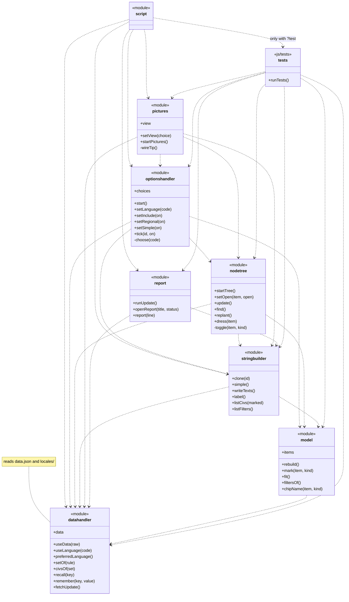

# AoE2 Civ Explorer: maintainer's guide

1. [Updating Civ Explorer after a game patch](#updating-civ-explorer-after-a-game-patch)
2. [How the code works](#how-the-code-works)
   - [Files and folders](#files-and-folders)
   - [UML diagram](#uml-diagram)
   - [The data](#the-data)
   - [How marking works](#how-marking-works)
   - [Simple UI and the pictures](#simple-ui-and-the-pictures)
   - [Assets](#assets)
   - [Tests](#tests)
   - [Rules for changing the code](#rules-for-changing-the-code)

## Updating Civ Explorer after a game patch

After a patch, [aoe2techtree.net](https://aoe2techtree.net/) publishes the game's new data. The page has an updater
built in: it fetches that data, tells you what changed, and gives you new data files to save. You need a browser, a
text editor such as Visual Studio Code, and about ten minutes. You do not need to know how to program.

1. **Wait for aoe2techtree.net.** Its footer says which game update its data comes from. Wait until that matches the
   new patch.
2. **Open the page on your computer.** A browser will not let a page read files straight from your disk, so the
   folder has to be served. In Visual Studio Code with the Live Server extension, open the project folder, right-click
   `index.html` and choose **Open with Live Server**. The page opens at an address such as
   `http://127.0.0.1:5501/index.html`. You can also use the published page's address instead.
3. **Run the updater.** Add `?update` to the address, for example `http://127.0.0.1:5501/index.html?update`. A window
   called **Update the data files** fetches the new data, which takes a few seconds, and lists what it found. Nothing
   is changed yet.
4. **Read the report.** Most lines need nothing from you. These do:
   - *In the source data, but not yet in the tree: …* The patch added a building, unit or technology. Put it in the
     tree (step 5), or add its name to `ignore` in `data.json` to leave it out.
   - *In the tree, but not in the source data: …* or *In the tree more than once: …* Fix the tree (step 5). The
     updater stops until you do.
   - *No civilisation has: …* It was probably removed from the game. Consider removing it from the tree.
   - *In the source data now, so it can be taken out of extras: …* aoe2techtree.net now has an item that was added
     by hand. Delete its entry under `extras` in `data.json` (see [The data](#the-data)) and reload the `?update` page.
   - *New icon for …: …* If the file it names is not in the project yet, copy it from the `img` folder of
     [aoe2techtree's repository](https://github.com/SiegeEngineers/aoe2techtree): `img/Unit/912.png` goes to
     `assets/images/icons/nodes/unit/912.png`, and the same for `Building` and `Tech`.
   - *New civilisation: …* Its names are added for you. Add its icon to `assets/images/icons/civs/`, named after its
     English name in lower case, such as `celts.png`.
   - *… has no text for: …* A language file is missing a sentence or a heading. Add it under `text` in that file (see
     [The data](#the-data)).
   - *New name in … for …: …* Nothing, unless the new name is wrong. Then add the right one to `overrides` in that
     language's file, with the English name on the left, such as
     `"Heavy Mounted Crossbowman": "Schwerer berittener Armbrustschütze"` in `locales/de.json`. English corrections
     go in `overrides` in `data.json`. Reload the `?update` page afterwards.
5. **Change the tree, if the report asked you to.** Open `data.json` and find `"tree"`. It reads like an outline:
   each entry is a row of the left pane, and `"kids"` lists the rows under it.

   ```json
   {"item": "Stable", "kids": [
     {"item": "Scout Cavalry", "kids": [
       {"item": "Light Cavalry", "kids": [
         {"item": "Hussar"}
       ]}
     ]},
   ```

   - `"item"` is the English name, **exactly** as the report wrote it.
   - Put a building at the top or in a group, its units and technologies under it, and each upgrade under the unit
     or technology it upgrades, as Light Cavalry is under Scout Cavalry. Walls and towers in Fortifications are
     lines too, as the Keep is under the Guard Tower. Marking works along these lines (see
     [How marking works](#how-marking-works)).
   - A new unique unit goes straight into the building that trains it, after its other units and before its
     technologies, as the Grenadier is in the Archery Range; only the Castle keeps a Unique Units group. A new unique
     technology goes into the Castle's Unique Technologies. Both keep the alphabetical order of the unique items
     around them. A unique upgrade goes under the unit it upgrades instead, as the Imperial Skirmisher is under the
     Elite Skirmisher. A new unique building has no group: it goes straight into Economy or Military, next to the
     building it stands in for (see `"replaces"` in [How marking works](#how-marking-works)), or under the building it
     belongs to, as the Harbor is the first row under the Dock. A unit or technology that stands in for another, as
     the Fire Lancer does for the Eagle Scout, Cranequins for Parthian Tactics and the Legionary, under the Long
     Swordsman, for the Two-Handed Swordsman, names it with `"replaces"` too.
   - Every entry in a list is followed by a comma, except the last one. Visual Studio Code underlines mistakes in red.

   Reload the `?update` page. The report should no longer mention those items.
6. **Download the new files.** At the end of the report's list, which scrolls between the window's title and its
   **Close** button, is a link for each file that changed: always **Download data.json**, and one for each language
   file that changed, such as **Download locales/de.json**. Save each over the old file of the same name.
7. **Run the tests.** Open the page with `?test` instead, such as `http://127.0.0.1:5501/index.html?test`, and wait
   about half a minute. A window then says **All … tests passed**, or names the tests that failed by their number in
   `TESTS.md`, each with what is wrong and where.
8. **Publish.** Commit the changed files and push them, for example with GitHub Desktop. GitHub runs the tests again
   in several window sizes, in light and dark colours; a green tick in the repository's **Actions** tab means they
   all passed.

## How the code works

The page is plain HTML, CSS and JavaScript. There is nothing to install and nothing to build: the files in the
project are exactly what a visitor's browser downloads. The most important idea is that **all facts and all text
live in `data.json` and the language files**. The code never names a unit, a civilisation or a sentence, which is
why a game update changes only those files, and sometimes adds an icon.

### Files and folders

| File or folder | What it holds |
| --- | --- |
| `index.html` | The structure of the page. It holds no text of its own. |
| `style.css` | How the page looks, for big and small screens, light and dark colours, with or without pictures. |
| `script.js` | Where the page starts. The rest of the code is in `js/`. |
| `js/` | The scripts; see [UML diagram](#uml-diagram). |
| `js/tests/` | The tests, loaded only when the address ends in `?test`; see [Tests](#tests). |
| `data.json` | The data and the English text; see [The data](#the-data). |
| `locales/` | One file per other language, such as `de.json` for German. |
| `assets/` | Pictures and fonts, used only when Simple UI is off; see [Assets](#assets). |
| `documentation/` | This guide, `RULES.md`, `REQUIREMENTS.md`, `TESTS.md`, `DEVLOG.md` and `code_docu.pdf`. |
| `README.md` | Introduces the project. |
| `.github/workflows/tests.yml` | Tells GitHub to run the tests on every push. |

`code_docu.pdf` describes every function in the code, one by one.

### UML diagram

Each arrow points from a script to a script it uses. `+` marks what a script shares with others, `-` what it keeps to
itself.



- **`script.js`** turns Simple UI on or off as the visitor last chose, loads `data.json` and the visitor's language,
  and starts the page. With `?test` it loads the tests, and with `?update` the updater.
- **`js/datahandler.js`** looks after the data: loading `data.json` and the language files, the chosen language,
  which civilisations have what, the visitor's saved choices, and the updater's fetching and file writing.
- **`js/model.js`** holds the tree and its rules: which items are shown, how marks pass on (see
  [How marking works](#how-marking-works)), which civilisations fit, and what **Filters** shows. It never touches the
  page.
- **`js/stringbuilder.js`** writes the page's text: the fixed texts, the chosen language's texts, the names in the
  tree, the list of civilisations and **Filters**.
- **`js/nodetree.js`** draws the tree and handles it: opening and closing, counts, marking by click, touch and key,
  **Find**, and the buttons above it.
- **`js/optionshandler.js`** runs the Options window: the language menu, the Include boxes and Simple UI. Each
  setting is one of its `choices`; `js/pictures.js` adds the civilisations' view and Tooltips.
- **`js/pictures.js`** holds what only the pictures need: the civilisations as a list or as tiles, and the tooltip.
- **`js/report.js`** shows the report window of the updater and the tests. Its title, its summary and its **Close**
  button stay in view, and only the list between them scrolls. **Close** sits on the right and is the plain button
  of Simple UI, even with the pictures on.

A script only uses the scripts below it in this order: `datahandler.js`, `model.js`, `stringbuilder.js`,
`nodetree.js`, `optionshandler.js`. Keep it so, so that the arrows never go round in a circle.

### The data

`data.json` is a text file in JSON format. Its parts:

- `source`: where the data comes from and when it was fetched, and Microsoft's notice for the footer, with the
  addresses its two links lead to: Microsoft's rules, and, from "Civ Explorer", the project on GitHub.
- `languages`: the 17 languages, English first. Each has its `name`, its `tag` (such as `pt-BR`) and two settings the
  updater uses to tidy the game's names.
- `civs`: the civilisations, by their English names.
- `icons`: where the icons are, the tab icon, and the civilisations whose icon has another name than theirs.
- `tree`: the rows of the left pane, where a group can be marked `"unique": true` or `"lines": true`, and an item
  can be marked `"own": true`, or name an item it `"excludes"`, or the items it `"replaces"` (see
  [How marking works](#how-marking-works)). **Edited by hand.**
- `availability`: which civilisations have each item. **Written by the updater; never edit it.**
- `pictures`: each item's icon, and whether it is common, regional or unique. **Written by the updater.**
- `ignore`: names from the game that the page leaves out. **Edited by hand.**
- `extras`: items that aoe2techtree.net gives to no civilisation, so that the page has to be told about them, such as
  the Xolotl Warrior. The updater takes them from here instead. **Edited by hand.**
- `overrides`: corrections to English names. **Edited by hand.**
- `tools`: the updater's and the tests' messages, in English only.
- `text`: the English text: `ui` holds the page's sentences, `groups` the headings in the tree, and `civs` and `items`
  the names, which the updater writes.

Each file in `locales/` holds `overrides` and `text` for one more language. A visitor's browser only downloads
`data.json` and the file of the language it shows.

When you change a sentence under `text` → `ui`:

- Keep the words in braces, such as `{n}` or `{name}`. The page fills them in, and the tests check that every
  language has the same ones as English.
- A text with a count, such as `"compatible"`, has a form for each kind of number: `"one"`, `"few"`, `"many"` and
  `"other"`. English needs `"one"` and `"other"`; Polish and Russian also need `"few"` and `"many"`. Every count
  needs `"other"`.

To add a language, it must exist on aoe2techtree.net, as the names come from there:

1. Add it to `languages` in `data.json`, copying `spaces` and `mergeHyphens` from a similar language.
2. Create `locales/<code>.json`, such as `locales/pt.json`, as `{"overrides": {}, "text": {"ui": …, "groups": …}}`,
   with `ui` and `groups` copied from `data.json` and translated.
3. Run the updater, download its files, and run the tests. The updater fills in all the names.

To add an item that aoe2techtree.net gives to no civilisation, as the Xolotl Warrior was added:

1. Put it in the tree (step 5 of the update guide).
2. Add it to `extras`, like the Xolotl Warrior: its `kind` (`unit`, `tech` or `building`), the number of its icon as
   `picture`, its `reach` (`common`, `regional` or `unique`), the number of its name in aoe2techtree's
   [English names](https://aoe2techtree.net/data/locales/en/strings.json) as `nameId`, and the civilisations that
   have it as `has`.
3. Save its icon, a 48 by 48 PNG, in `assets/images/icons/nodes/` under its kind, named after its picture number.
4. Run the updater, download its files, and run the tests. The updater fills in its names in every language.

### How marking works

A visitor marks an item **must have** with a click and **must lack** with a right-click, a long press or X. Where an
item sits in the tree decides what else its mark reaches:

- An item with no other item above it, only groups or nothing, is a **building**, such as the Barracks. Marking a
  building or a group marks everything in it, and opens it all.
- A group inside an item is only a **heading**, as the Castle's Unique Units, at its top, and Unique Technologies,
  between the Trebuchet and Hoardings, are. It has no checkbox and cannot be marked; a click on its name or its arrow
  opens and closes it, and the arrow keys stop on its arrow. Marking the Castle still marks everything in them.
- An item under another item is a **unit or technology**, often the start of a line of upgrades. Its mark passes down
  that line, until it forks, but only to the items that the same civilisations have (requirements 29 and 30): marking
  Militia (52 civilisations) also marks Man-at-Arms (the same 52), but not Long Swordsman (51), and marking the Camel
  Scout (the Gurjaras) does not mark the Imperial Camel Rider (the Hindustanis).
- The items in a group marked `"lines": true` count as units and technologies too. That group is Fortifications,
  whose walls and towers are lines of upgrades (requirements 24, 25 and 30): marking the Watch Tower (55) does not
  mark the Guard Tower (51).
- Must have also passes up, to every unit and technology above the item, which are its prerequisites, but never to a
  building (requirement 34): marking Two-Man Saw marks Bow Saw and Double-Bit Axe too, but not the Lumber Camp, and
  marking the Keep marks the Guard Tower and the Watch Tower. So Double-Bit Axe cannot lose must have while Two-Man
  Saw keeps it: clearing it, or marking it must lack, clears Two-Man Saw too. It stops below an item that some
  civilisations with the item lack, as that is no prerequisite for them (one of requirement 34's unique edge cases):
  marking the Camel Rider does not mark the Camel Scout, which only the Gurjaras have, and marking the Camel Scout
  must lack leaves the Camel Rider marked. Marking everything in a building marks all in it but the building itself,
  which shows a dash. Must lack never passes up.
- Marking opens the item down to its first fork, and every row the mark reached.
- An item can name another item that no civilisation has together with it, as the Xolotl Warrior names the Stable:
  `{"item": "Xolotl Warrior", "excludes": "Stable"}`. While the Xolotl Warrior is marked must have, the Stable and
  everything in it but the Xolotl Warrior are greyed out and cannot be marked. While the Stable, or anything in it,
  is marked must have, the Xolotl Warrior is greyed out. Must lack greys out nothing. The Stable stays open, so the
  Xolotl Warrior stays in sight, and its arrow still works; the rows in it are closed, as greyed-out items are.
  Otherwise the Xolotl Warrior is not part of the Stable: marking the Stable must lack leaves it alone, and "Full
  Stable" does not count it. It is the first row under the Stable, so that marking it opens only rows below it.
- An item can name the items it stands in for, one by name or several in a list. The Fortified Church names the
  Monastery, the Folwark the Mill, the Pasture the Farm, the Donjon the Watch Tower, the Mule Cart and the Settlement
  the drop-off sites their civilisations lack, the Varangian Guard and the Fire Lancer the Eagle Scout, the Dromon,
  the Catapult Galleon and the Lou Chuan the Cannon Galleon, the Champi Scout the Militia, the Legionary the
  Two-Handed Swordsman, the Savar the Paladin, the Winged Hussar the Hussar, the Armored Elephant the Battering Ram,
  the Rocket Cart the Mangonel, and Cranequins Parthian Tactics:
  `{"item": "Fortified Church", "replaces": "Monastery"}`
  `{"item": "Mule Cart", "replaces": ["Lumber Camp", "Mining Camp"]}`
  The page then also shows, under it, everything in those items but their unique items and unique groups, in the order
  named, so their technologies are listed only once in `data.json`, but the Missionary, a unique unit, stays the
  Monastery's, and the Warrior Priest the Fortified Church's. An item that counts as a unit or technology lends nothing,
  as its rows are its own upgrades: the Donjon shows neither the Guard Tower nor the Keep, which the Sicilians lack, as
  they lack the Watch Tower. Nor is a row marked `"own": true`, or anything under it. The Domestication line, which only
  the Khitans have, is marked so: `{"item": "Domestication", "own": true, "kids": [...]}`. The Folwark and the
  Settlement thus show the Mill's Horse Collar line, but not its Domestication line. Such rows are the same items in
  every place: marking Two-Man Saw under the Mule Cart marks it under the Lumber Camp and the Settlement too, with one
  entry in **Filters**, and opens nothing elsewhere (requirement 31 allows this). While an item is marked must have, its
  alternatives are greyed out and closed, and cannot be marked or opened until the mark is cleared (requirement 37).
  They are the items it names, the items that name it, and the other items that name what it names. Marking the Folwark
  greys out the Mill and the Settlement, which names the Mill too; marking the Settlement greys out the Mill, the Lumber
  Camp, the Mining Camp, the Folwark and the Mule Cart; marking the Fire Lancer greys out the Eagle Scout and the
  Varangian Guard. The Folwark and the Mule Cart name nothing in common, so neither greys out the other. Greying never
  adds rows to an item. An item that is marked must have itself is never greyed out: marking the Economy group marks the
  Lumber Camp and the Mule Cart alike, and either can still be cleared.
- In **Filters**, a fully marked building or group with more than one row under it reads "Full", such as "Full
  Blacksmith" (requirement 24). A line is named after its deepest item marked must have, such as "Champion" or
  "Keep", and so is a building at the top of a single line: a fully marked Lumber Camp reads "Two-Man Saw".
- A unique item marked must have always has its own entry in **Filters** (requirement 36), unless every item in
  its line is unique, as in the Gbeto line, which reads "Elite Gbeto". A fully marked Folwark reads "Folwark" and
  "Crop Rotation", and even a full Economy lists "Folwark" beside "Full Economy". Clearing the Folwark's entry
  clears only the Folwark, and clearing any other entry leaves it marked. The page counts an item as unique by its
  `reach` in `pictures`.

Some items are left out of the tree unless the visitor ticks **Include Unique and Universal** in Options: the groups
marked `"unique": true` (the Castle's Unique Units and Unique Technologies), the items aoe2techtree calls unique, such
as the Harbor and the Grenadier, and the items that all civilisations, all but one, or only one has, such as the
House, which only the Huns lack. The page works these out by itself, and keeps such an item when something under it is
shown, such as the Watch Tower above the Guard Tower. A unique unit that is left out leaves the rows under it in its
place: without the Camel Scout, the Camel Rider is a row of the Stable.
Unticking **Include Regionals** also leaves out the items aoe2techtree calls regional, such as the Eagle Scout.

### Simple UI and the pictures

**Simple UI**, a box in the Options window, turns every picture off: the page then uses no images at all, not even
the tab icon, and a visitor who chose it never downloads a picture or a font. The page's look and its accessibility
rules are the ones `REQUIREMENTS.md` and WCAG 2.2 AAA ask for with Simple UI on (requirement 0, Rule 22); the way
marking works is the same in both modes.

It works through one class: with Simple UI off, `<html>` has the class `pictures`. Every rule in `style.css` that
uses a picture or a font starts with `.pictures`, so none of them applies with Simple UI on. The icons in the tree and
the list are only made while the class is there, and the tab icon in `index.html` is empty (`data:,`) until
`js/optionshandler.js` sets it with Simple UI off.

With the pictures on, the page also looks a little different: the title is the short "Civ Explorer", the legend is
hidden as the tooltip explains the same, the Find box comes first, Include's description shows as a tooltip, the
civilisations can be shown as tiles and link to their pages on aoe2techtree.net, and the mouse cursor is a sword.

Under the Find box there are then two buttons instead of three: **Clear**, and **Expand all**, which turns into
**Collapse all** in the same place while a branch at the top of the tree is open. Together they are as wide as the
pane, whatever the language. Each shows the whole button picture in its own proportions, so in a narrow window the
buttons and their text get smaller. Simple UI keeps the three buttons.

The Options window then shows its **Cancel** and **OK** buttons as the whole button picture, on the parchment below
the window's panel, in the parchment's bottom right corner: as far from its right edge as from its bottom edge. In a
window less than 588 pixels high the parchment is left out, and the buttons stay at the bottom of the panel. No
button's text has a shadow; only the civilisations' names on tiles have one. With or without Simple
UI, a change made in the window, a new language included, only shows in the window until **OK** applies it;
**Cancel**, Escape or closing the window in any other way drops it, and the window opens again showing what applies.
With Simple UI, the window is 10 pixels larger on every side, and there are 5 more pixels between the rows from its
title to its buttons.

The focus outline of a box or a language in the Options window is drawn just inside its edges, as in the tree,
because the scrolling list around it would cut off an outline drawn outside.

### Assets

| Folder | Holds |
| --- | --- |
| `assets/images/ui/backgrounds/` | The parchment behind the page in four sizes, the Options window's parchment and the title's frame. |
| `assets/images/ui/buttons/` | The cogwheel, the text buttons, the Find box and its search and clear icons. |
| `assets/images/ui/checkboxes/` | The checkboxes and the radio buttons. |
| `assets/images/ui/cursors/` | The mouse cursors. |
| `assets/images/ui/panels/` | The panes' frames and the box of a civilisation tile. |
| `assets/images/icons/civs/` | The civilisations' icons. |
| `assets/images/icons/nodes/` | The tree's icons, in `building/`, `unit/`, `tech/` and `misc/`, and `colour_key.csv`. |
| `assets/images/favicon.ico` | The tab icon. |
| `assets/fonts/` | Georgia, Times New Roman Bold and Trajan Pro Bold, used only with the pictures. |

- Most pictures come in two sizes: `_sd` for windows up to 1920 by 1080, and `_4k` for bigger windows and sharp
  screens. The parchment comes as `fhd`, `qhd`, `uhd` and `ultrawide`, and the browser downloads only the one that
  suits the window.
- A picture with several states, such as a checkbox, holds them all in one sheet: rows for empty, ticked and
  crossed, and columns for normal, under the mouse and pressed. `style.css` shows the right part.
- To replace a picture, save the new one under the same name, as WebP and with the same proportions. Names use only
  lower-case letters, digits and underscores, and GitHub refuses other names and formats than WebP, PNG and ICO. If
  the parchment's frame is in another place, change `--left`, `--right`, `--top` and `--bottom` in the
  `.pictures body` rule of `style.css`: each is a position in the picture, divided by its width or height. Look at
  the page to check.
- The tree's icons are copied from aoe2techtree's repository and keep its file numbers. `pictures` in `data.json`
  says which file each item uses. The Xolotl Warrior's, `unit/1570.png`, is not there: it is the game's icon from
  the Age of Empires wiki, made 48 by 48, and numbered after the unit. The colour of an icon's outline depends on the
  item's kind and reach, as `colour_key.csv` says, and the same colours are copied into `style.css`: change both
  together. The tests compare them.
- The civilisations' icons are named after the civilisation in lower case. Where the file has another name, such as
  `inca.png`, `icons` in `data.json` says so.

### Tests

Open the page with `?test` to run the tests in your browser. They run in three rounds: functional tests,
accessibility tests and maintainability tests, in the order `TESTS.md` lists them, and the report names each by its
number there. GitHub runs them on every push, at four window sizes in light and dark colours, and also checks the
file names and that no folder holds too many files.

| File in `js/tests/` | Tests |
| --- | --- |
| `run.js` | Runs the rounds, shows the report, and checks that there are at most 100 tests. |
| `helpers.js` | No tests: shared helpers, and the sample items the tests use, picked from the data so that the tests survive game updates. |
| `behaviour.js` | Marking, **Filters**, counts, opening and closing, and **Find**. |
| `interface.js` | The keyboard, the language menu, every language, the Options window, the filters of unique items, and the runs of the accessibility audit. |
| `pictures.js` | The pictures, with Simple UI off. |
| `audit.js` | The accessibility audit (contrast, focus, sizes, names and more), which the other files run in many states. |
| `static.js` | The files themselves: the rules for the code, and mistakes in `data.json` and the language files. |

There may be at most 100 tests. When you add, change or remove one, update `TESTS.md`. Tests cannot prove everything
about accessibility, so after bigger changes also try the page with Simple UI on, with only a keyboard, at 400% zoom
and with a screen reader.

### Rules for changing the code

`RULES.md` has the full list, and the tests check most of it.

- HTML only in `index.html`, CSS only in `style.css`, JavaScript only in `script.js` and `js/`, and facts and text
  only in `data.json` and `locales/`.
- No file over 400 lines of code, no function over 60, and no line of a script over 120 characters. No folder over
  7 files, except `assets/` and `locales/`; the main folder may hold 8. `js/` and `js/tests/` are full, so move code
  into a script with room, merge two scripts, or start a folder inside `js/`.
- No comments in the code, and a blank line before and after every function.
- No pictures outside `assets/` and `.pictures` rules, and no sounds, animations, libraries, build steps or Python.
- No button, box or other control may move on the screen while the visitor uses it, and the page itself never
  scrolls with every branch closed.
- `REQUIREMENTS.md` defines the page, and only the chief developer may change it.
- Record what you change, and why, in `DEVLOG.md`.
